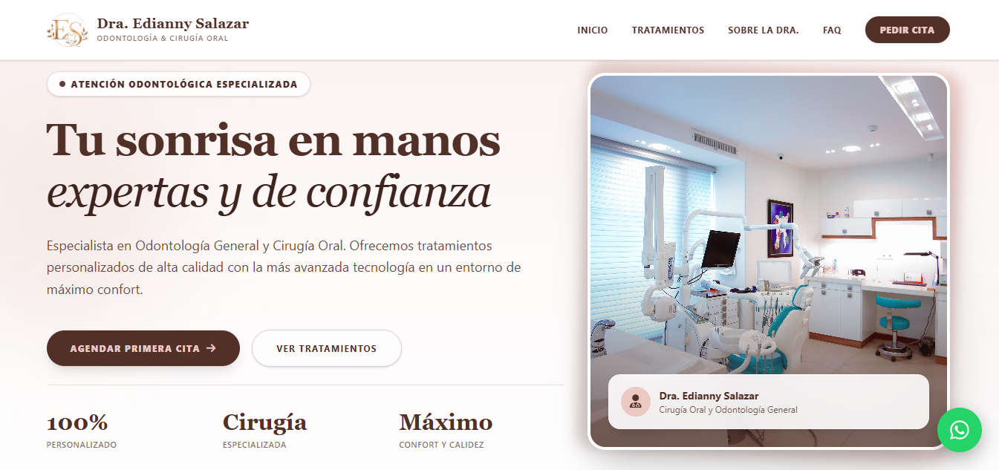

# 🦷 Landing Page - Dra. Edianny Salazar



Landing page profesional y moderna desarrollada para servicios odontológicos, diseñada con una interfaz limpia, adaptable y completamente responsive para ofrecer una excelente experiencia de usuario en cualquier dispositivo.

## 🚀 Tecnologías utilizadas

Este proyecto ha sido construido utilizando herramientas modernas de desarrollo web frontend:

- **React** (con Vite para un rendimiento ultrarrápido)
- **Tailwind CSS** para un diseño moderno y adaptable
- **JavaScript (ES6+)**
- **Git & GitHub** para el control de versiones y despliegue

## 📱 Características principales

- **Diseño Responsive:** Adaptado perfectamente a dispositivos móviles, tablets y ordenadores de escritorio.
- **Navegación Fluida:** Barra de navegación interactiva y optimizada para accesibilidad móvil.
- **Identidad Visual:** Integración de logotipo personalizado y paleta de colores corporativa orientada al sector salud.

## 💡 Aprendizajes y enfoque técnico
Durante el desarrollo de esta landing page se aplicó un enfoque *Utility-First* combinando **React** y **Tailwind CSS** sobre **Vite**:
- **Componentización y Estilos:** La integración de Tailwind directamente en la estructura JSX de React permitió construir una interfaz moderna y coherente sin necesidad de gestionar archivos CSS externos extensos.
- **Flujo de desarrollo ágil:** El uso de Vite garantizó un refresco instantáneo en el navegador (HMR), optimizando el tiempo de desarrollo y la prueba de componentes en tiempo real.
- **Buenas prácticas:** Estructura modular de componentes y control de versiones mediante un flujo de Git limpio y libre de conflictos de entorno.

## 🛠️ Instalación y ejecución local

Si deseas clonar y probar este proyecto en tu entorno local, sigue estos pasos:

1. Clona el repositorio:
   ```bash
   git clone [https://github.com/danieltauil20/landingES.git](https://github.com/danieltauil20/landingES.git)
